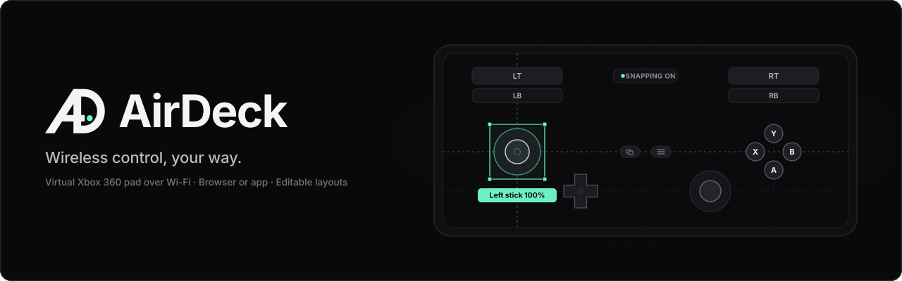

# AirDeck for Android

Turn your Android phone into a wireless PC game controller. Editable layouts, game rumble, tilt steering and custom response curves.

[Download](https://github.com/horse-3903/AirDeck-Mobile/releases) | [Try it in your browser](https://horse-3903.github.io/demos/airdeck-demo.html) | [AirDeck docs](https://github.com/horse-3903/AirDeck) | [PC server](https://github.com/horse-3903/AirDeck-PC)

---

## Why AirDeck

The app draws a full game controller on your phone and sends it to your Windows PC over Wi-Fi. The PC sees a normal Xbox controller. It needs the free [AirDeck PC server](https://github.com/horse-3903/AirDeck-PC) on the same network.

- **Complete controller** - two sticks, D-pad, face buttons, bumpers, analog triggers, View, Start and Back, in Xbox, PlayStation or Joy-Con style.
- **Fully editable** - move, resize, stretch, hide and group any control, with snapping, undo and a live preview.
- **Layout library** - save named layouts, reorder, import and export, and switch mid-game. Racing, platformer, shooter, fighting and party layouts come ready-made.
- **Tuned for the game** - sticks, D-pad, triggers and haptics follow your defaults unless a layout overrides them.
- **Feels right** - game rumble, tilt steering, floating sticks and response curves you can draw yourself.
- **Stays connected** - automatic reconnect, a foreground service, and Back that keeps the link open.

For every option, see the [feature guide](https://github.com/horse-3903/AirDeck/blob/main/docs/features.md).

---

## Quick start

1. Start the [AirDeck PC server](https://github.com/horse-3903/AirDeck-PC) and open Connect device.
2. Install the APK from [Releases](https://github.com/horse-3903/AirDeck-Mobile/releases). It is debug signed, so Android asks you to allow installs from your browser or file manager.
3. Open the app, press Connect to PC and scan the QR code, or type `ip:port`.

The controller opens with your player number in the top row.

---

## Controls

| Control | What it does |
|---|---|
| Face buttons | A, B, X, Y as letters (Xbox), symbols (PlayStation) or Joy-Con labels |
| D-pad | Position picks the direction, sliding switches it, two fingers hold two |
| Sticks | Touch to snap, drag to move, hold still to press |
| Bumpers and triggers | LB, RB, LT, RT. Triggers work as a button, drag or gradient |
| View and Start | The two centre buttons |
| Back arrow | Returns to the main page and keeps the connection |
| Badge | Connection state and player number. Tap to disconnect or reconnect |
| Gear | Quick settings: theme, style, layouts, import and export |

---

## Documentation

| Page | What is in it |
|---|---|
| [Getting started](https://github.com/horse-3903/AirDeck/blob/main/docs/getting-started.md) | Server install, connecting, hotspot use |
| [Features](https://github.com/horse-3903/AirDeck/blob/main/docs/features.md) | Every control and option |
| [Layouts](https://github.com/horse-3903/AirDeck/blob/main/docs/layouts.md) | Editor, groups, per-layout settings, sharing |
| [Troubleshooting](https://github.com/horse-3903/AirDeck/blob/main/docs/troubleshooting.md) | Connection and controller problems |
| [Developing](docs/development.md) | Build, settings reference and releasing |
| [Architecture](docs/architecture.md) | How the app, connection and layouts fit together |
| [Roadmap](ROADMAP.md) | What is planned next |

The Android app is not on the Play Store yet. The user docs live in the [AirDeck repo](https://github.com/horse-3903/AirDeck) because the app and the browser controller share them.

---

## Requirements

| Part | Requirement |
|---|---|
| Phone | Android 8.0 or later |
| PC | Windows 10 or later running the [AirDeck PC server](https://github.com/horse-3903/AirDeck-PC), with the ViGEmBus driver for the Xbox 360 mode |
| Network | Phone and PC on the same network, or a phone hotspot the PC has joined |

Each [release](https://github.com/horse-3903/AirDeck-Mobile/releases) has a debug-signed APK, a `SHA256SUMS.txt` and notes on what changed.

---

## Support and contributing

Check [troubleshooting](https://github.com/horse-3903/AirDeck/blob/main/docs/troubleshooting.md) first. For bugs and ideas, [open an issue](https://github.com/horse-3903/AirDeck/issues) with your phone model and Android version. Pull requests are welcome: [docs/development.md](docs/development.md) covers building and the project layout.

---

## Credits and licence

Built on [VirtualGamePad-Mobile](https://github.com/kitswas/VirtualGamePad-Mobile) by [kitswas](https://github.com/kitswas). Released under the GNU General Public License v3.0, see [LICENCE.TXT](LICENCE.TXT).
